# Work1 Secure REST API

A secure REST API lab project built with FastAPI: JWT authentication, bcrypt password hashing, and parameterized queries to prevent SQL injection.

## 1. Project Overview

This project is a REST API with complete authentication and security hardening. It exposes three endpoints: login, data retrieval, and profile. Every protected endpoint requires a valid JWT Bearer Token.

## 2. Tech Stack

- Python 3.12
- FastAPI + Uvicorn
- PyJWT (JWT issuance and validation, HS256)
- bcrypt (password hashing)
- SQLite (data storage with parameterized queries)

## 3. Environment & Installation

```bash
# Install dependencies
pip install -r requirements.txt

# Start the server
py -m uvicorn app:app --reload
```

The service listens on `http://127.0.0.1:8000` by default; interactive API docs are available at `/docs` (Swagger UI).

## 4. API Endpoints

| Method | Path | Description | Auth |
|--------|------|-------------|------|
| GET | `/health` | Basic health check | None |
| POST | `/auth/login` | Username/password login, issues a JWT | None |
| GET | `/api/data` | Returns protected data | Bearer Token |
| GET | `/api/profile` | Returns the current user's profile | Bearer Token |

## 5. Security Features

- **bcrypt password hashing**: passwords are never stored in plaintext.
- **Parameterized queries**: all SQL statements use bound parameters to prevent SQL injection.
- **JWT authentication**: after login, an HS256-signed token is issued with a 24-hour expiry.
- **Uniform 401 handling**: distinguishes between "missing token", "expired token", and "invalid token" errors.

## 6. Testing & Verification

```bash
# Log in to obtain a Token
curl.exe -X POST http://127.0.0.1:8000/auth/login -H "Content-Type: application/json" -d '{"username":"Qs1r","password":"Zjx123456"}'

# Access a protected endpoint with the Token
curl.exe -H "Authorization: Bearer <token>" http://127.0.0.1:8000/api/data
curl.exe -H "Authorization: Bearer <token>" http://127.0.0.1:8000/api/profile
```

Screenshots of the tests are in the `docs/` directory (curl and Swagger verification results).

### API Test Screenshots

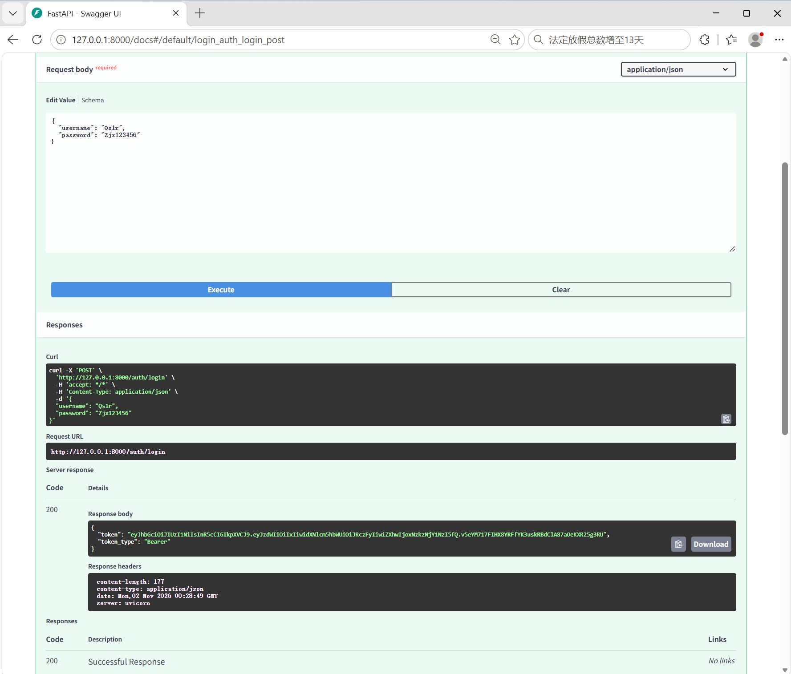

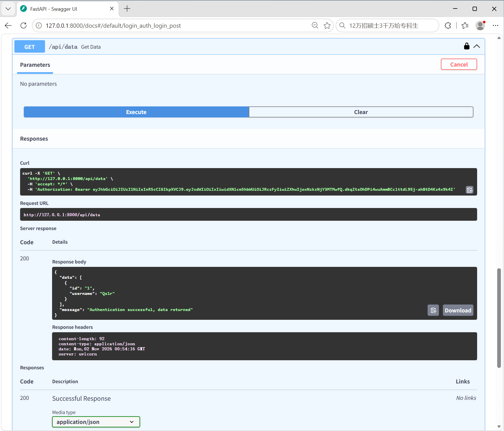

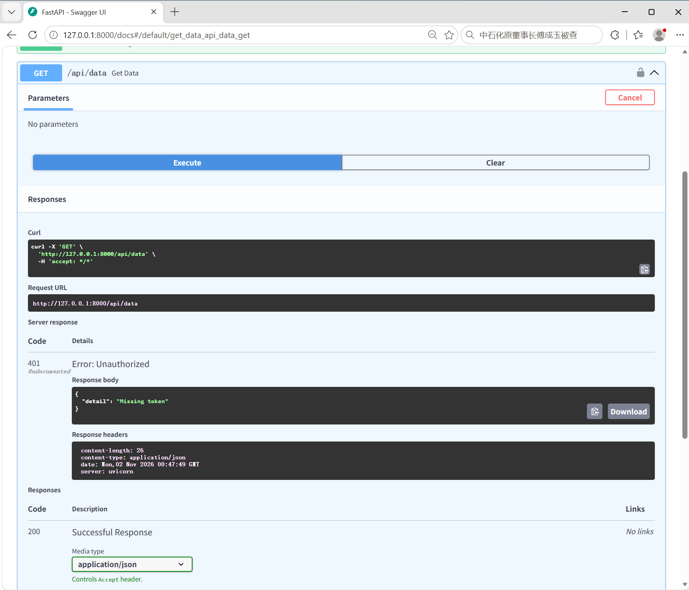

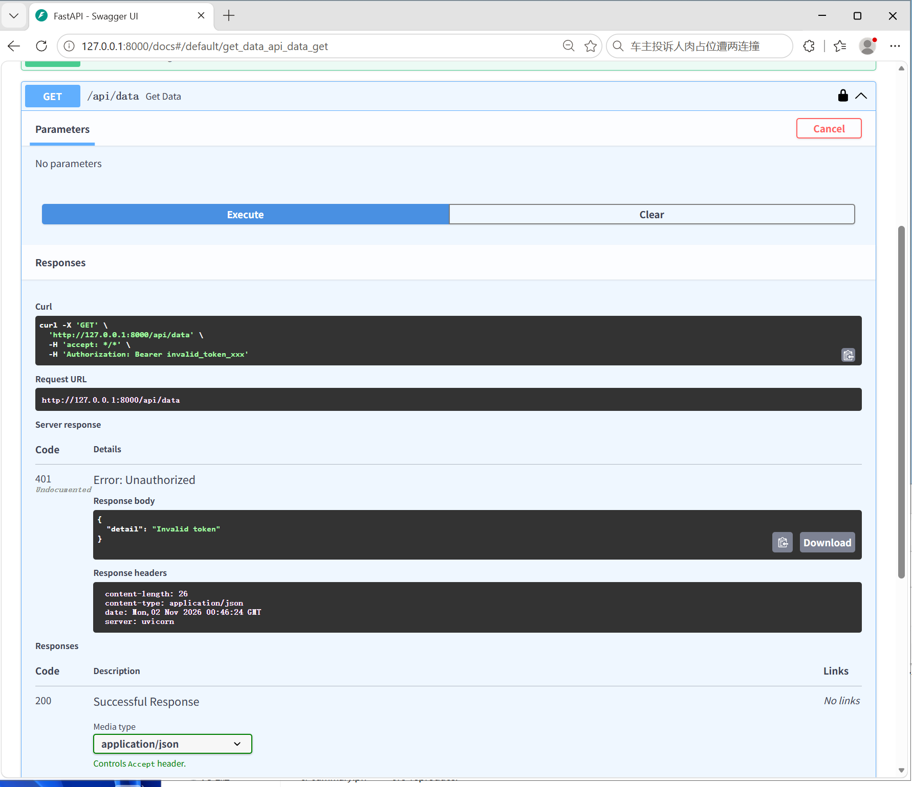

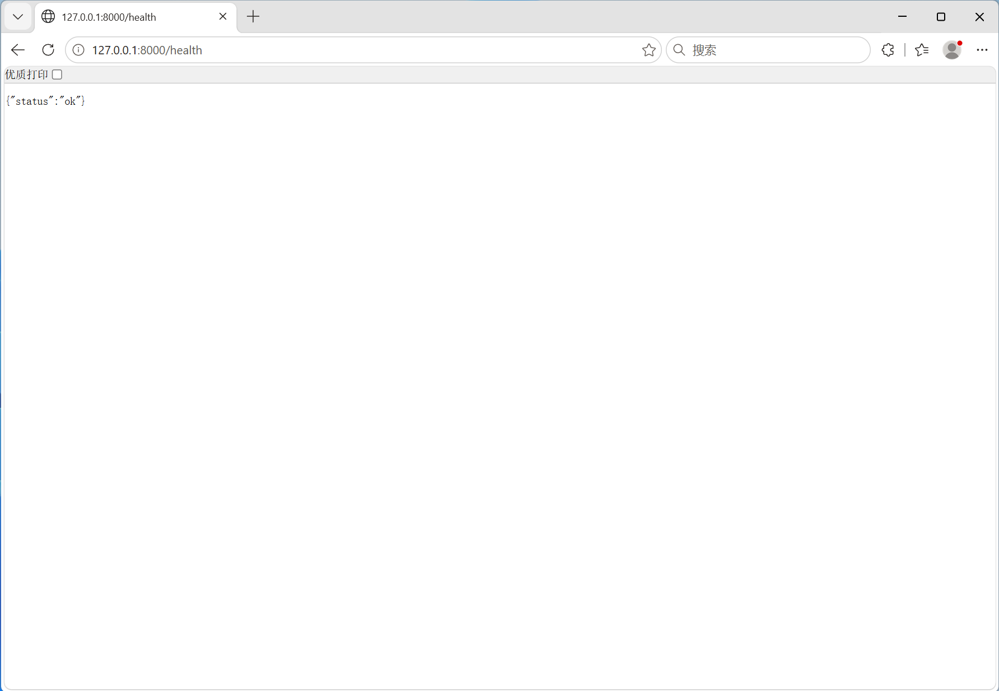

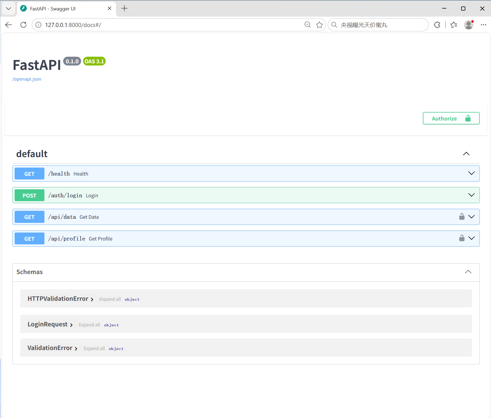

## 7. CI/CD Pipeline

Automated security scans via GitHub Actions:

- **bandit**: Python static application security testing (SAST).
- **Dependency-Check**: dependency vulnerability scanning (SCA).

The pipeline configuration is in `.github/workflows/ci.yml`. Most recent successful run:

> [Last successful pipeline run](https://github.com/Qs1r/work1-secure-api/actions/runs/41373188447)

### SAST/SCA Report Screenshots

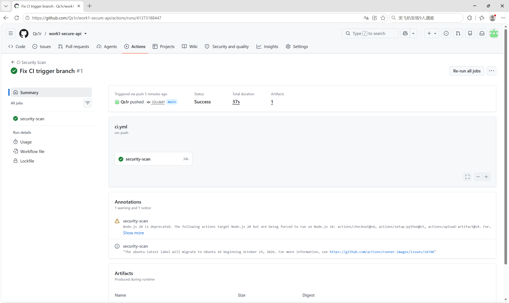

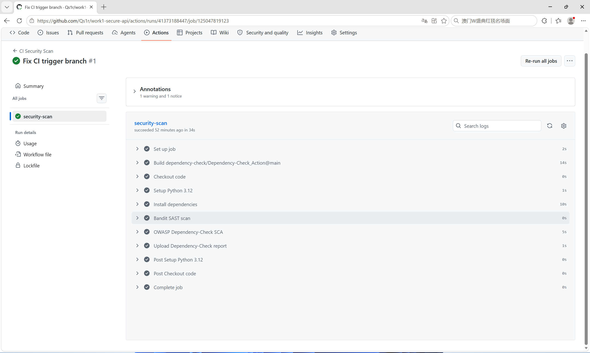

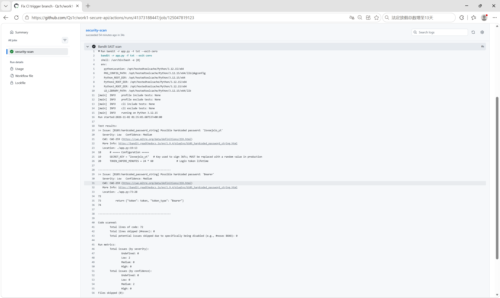

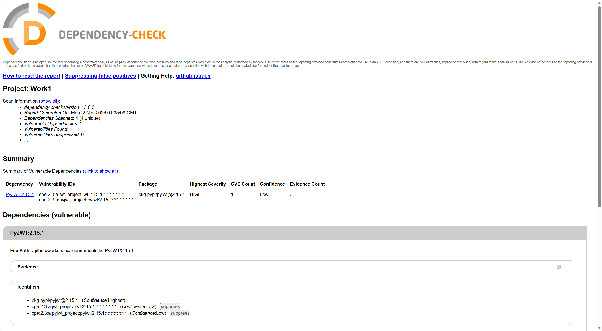

## 8. CVE Reproduction & Remediation

- **CVE-2014-6271 (Shellshock)**: reproduced the vulnerable environment with vulhub, analyzed the root cause, and proposed a remediation plan.
- **Reproduction conclusion**: by sending a malicious `User-Agent` header `() { :; }; echo; /usr/bin/id` to `victim.cgi`, command execution was successfully achieved on the unpatched Bash 4.3.0 (HTTP 200, returned `uid=33(www-data)`), confirming command injection; the same payload sent to the patched `safe.cgi` only returned a normal HTML page (Hello world) with no command output, proving the patch is effective.
- **Reproduction screenshot**: the left/top part shows the successful command injection against `victim.cgi`, and the right/bottom part shows the normal response from the patched `safe.cgi` — a side-by-side reproduction and remediation comparison.

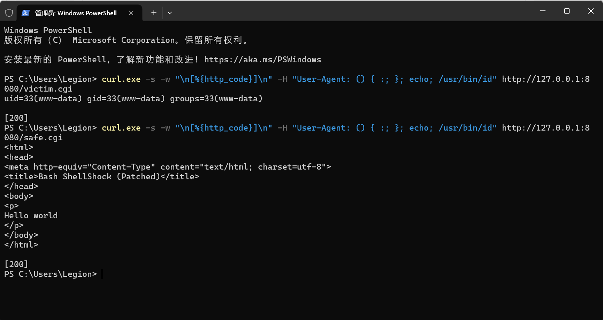

- **Remediation report**: [CVE-2014-6271-Shellshock-Remediation-Report.md](fix/CVE-2014-6271-Shellshock-Remediation-Report.md)