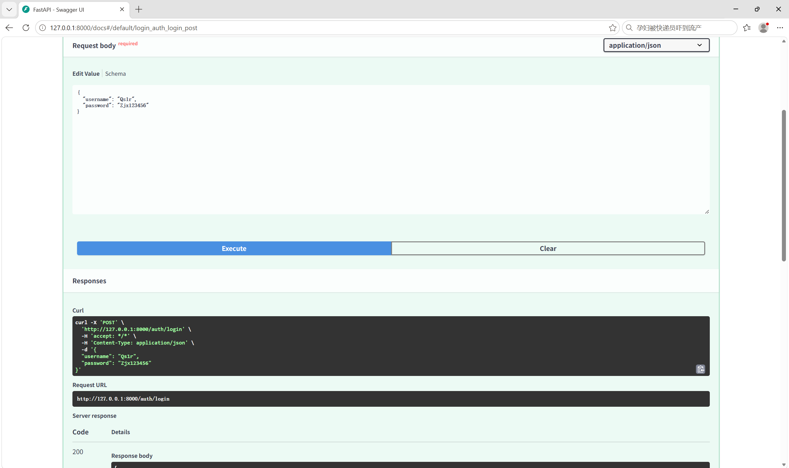
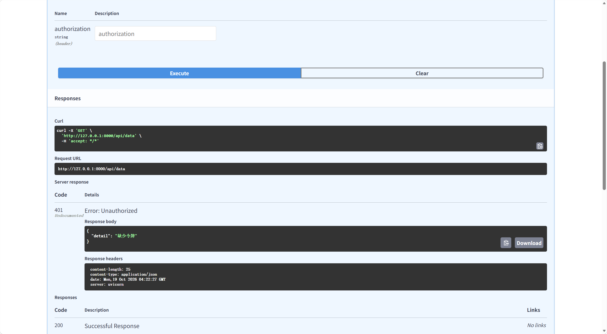
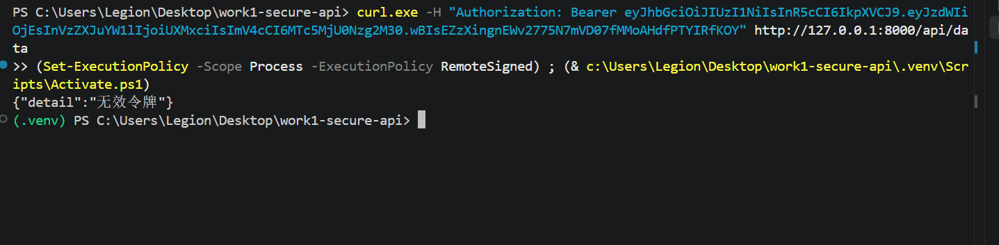
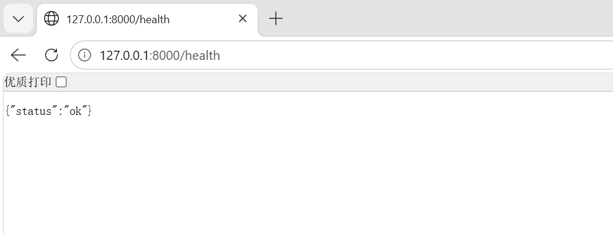
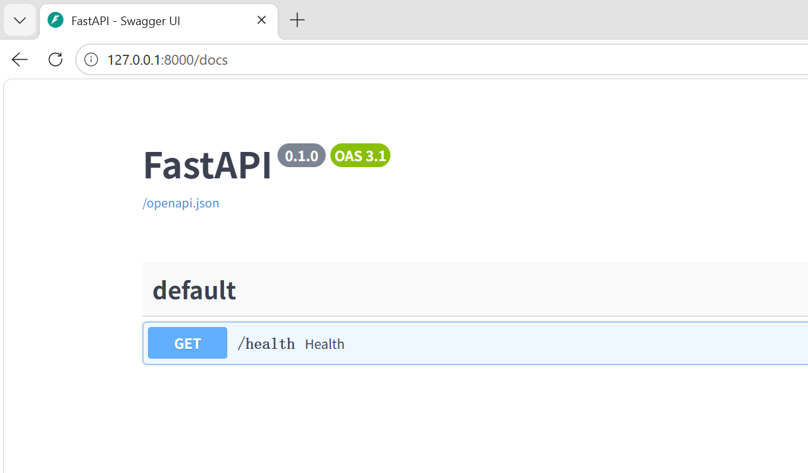
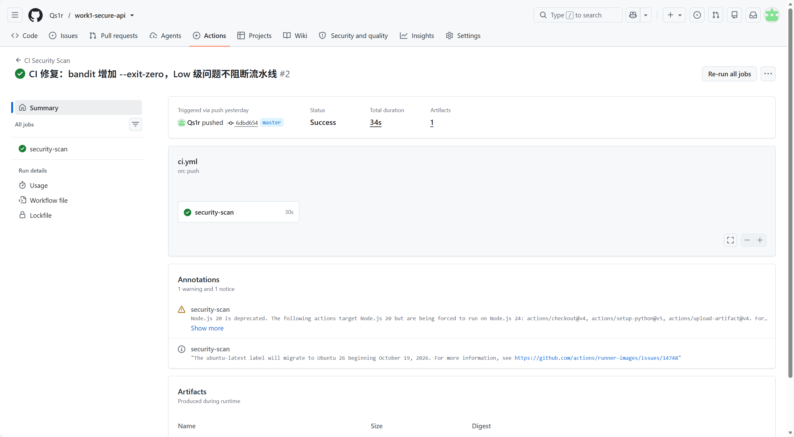
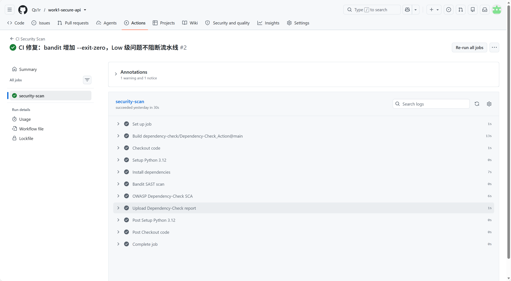
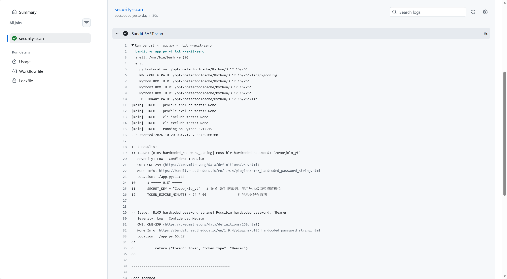
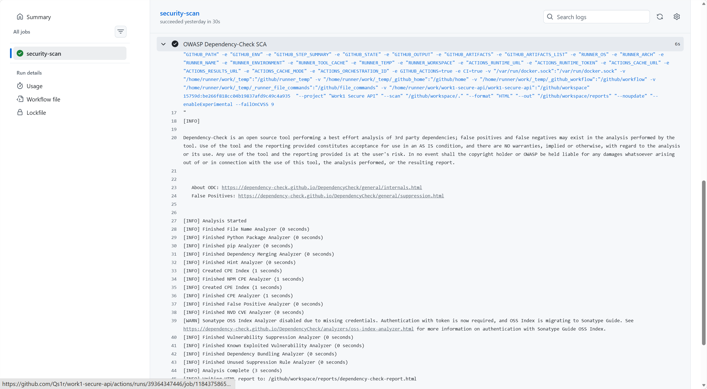

---
AIGC:
    Label: "1"
    ContentProducer: 001191440300708461136T1XGW3
    ProduceID: fa6d20be7fee21a8b0b752ab67751b4b_8c67c643cc3511f1b76f525400638852
    ReservedCode1: i6A4rqu6T+XnWkZoTKJQkLxyKKAdNFCY8gbF7t7DY5ieit1rn3RGnHy6YxtGML5z56nJx1W14uyrThdpyY57AQOlcppNnsnPP6+DrjPobkRjzbPuDrbVcxK0+PuIhj4KYasULfMzBy+39NGbz/VRu2xtToCa9cPeiHppc0AQcmXYCpkxqQh+HguUcgk=
    ContentPropagator: 001191440300708461136T1XGW3
    PropagateID: fa6d20be7fee21a8b0b752ab67751b4b_8c67c643cc3511f1b76f525400638852
    ReservedCode2: i6A4rqu6T+XnWkZoTKJQkLxyKKAdNFCY8gbF7t7DY5ieit1rn3RGnHy6YxtGML5z56nJx1W14uyrThdpyY57AQOlcppNnsnPP6+DrjPobkRjzbPuDrbVcxK0+PuIhj4KYasULfMzBy+39NGbz/VRu2xtToCa9cPeiHppc0AQcmXYCpkxqQh+HguUcgk=
---

# Work1 Secure REST API

基于 FastAPI 的安全 REST API 实验项目：实现 JWT 认证、bcrypt 密码哈希与参数化查询防 SQL 注入。

## 1. 项目简介

本项目是一个带完整认证与安全防护的 REST API，包含登录、数据获取与个人资料三个接口。所有受保护接口均要求携带有效的 JWT Bearer Token 才能访问。

## 2. 技术栈

- Python 3.12
- FastAPI + Uvicorn
- PyJWT（JWT 签发与校验，HS256）
- bcrypt（密码哈希）
- SQLite（数据存储，参数化查询）

## 3. 环境与安装

```bash
# 安装依赖
pip install -r requirements.txt

# 启动服务
py -m uvicorn app:app --reload
```

服务默认监听 `http://127.0.0.1:8000`，接口文档见 `/docs`（Swagger UI）。

## 4. 接口文档

| 方法 | 路径 | 说明 | 认证 |
|------|------|------|------|
| POST | `/auth/login` | 用户名密码登录，签发 JWT | 无 |
| GET | `/api/data` | 返回受保护数据 | Bearer Token |
| GET | `/api/profile` | 返回当前用户资料 | Bearer Token |

## 5. 安全特性

- **bcrypt 密码哈希**：数据库不存明文密码。
- **参数化查询**：所有 SQL 均使用参数绑定，防止 SQL 注入。
- **JWT 认证**：登录后签发 HS256 签名 Token，过期时间 24 小时。
- **统一 401 处理**：区分"缺少令牌 / 令牌已过期 / 无效令牌"三类错误。

## 6. 测试与验证

```bash
# 登录获取 Token
curl.exe -X POST http://127.0.0.1:8000/auth/login -H "Content-Type: application/json" -d '{"username":"Qs1r","password":"Zjx123456"}'

# 携带 Token 访问受保护接口
curl.exe -H "Authorization: Bearer <token>" http://127.0.0.1:8000/api/data
curl.exe -H "Authorization: Bearer <token>" http://127.0.0.1:8000/api/profile
```

测试截图见 `docs/` 目录（curl 与 Swagger 验证结果）。

### API 测试截图











## 7. CI/CD 流水线

GitHub Actions 自动化安全扫描：

- **bandit**：Python 代码静态安全分析（SAST）。
- **Dependency-Check**：依赖库漏洞扫描（SCA）。

流水线配置见 `.github/workflows/ci.yml`，最近一次成功运行：

> [最后一次成功流水线运行](https://github.com/Qs1r/work1-secure-api/actions/runs/39542958037)

### SAST/SCA 报告截图









## 8. CVE 复现与修复

- **CVE-2014-6271（Shellshock）**：使用 vulhub 复现漏洞环境，分析原理并给出修复方案。
- **复现结论**：通过构造恶意 User-Agent 请求头 `() { :; }; echo; /usr/bin/id` 访问 `victim.cgi`，成功在未打补丁的 Bash 4.3.0 上执行命令（HTTP 200，返回 `uid=33(www-data)`），确认命令注入；同一 payload 访问已打补丁的 `safe.cgi` 时仅返回正常 HTML（Hello world），无命令输出，证明补丁有效。
- **复现截图**：下图左侧/上方为 `victim.cgi` 命令注入成功，右侧/下方为 `safe.cgi` 修复后正常返回，为复现与修复对照截图。


- **修复报告**：[CVE-2014-6271-Shellshock-修复报告.md](fix/CVE-2014-6271-Shellshock-修复报告.md)
*（内容由AI生成，仅供参考）*
