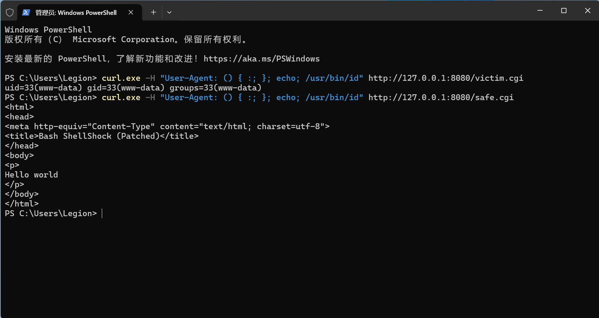

# CVE-2014-6271 Shellshock Remediation Report

## 1. Vulnerability Overview

- **CVE ID**: CVE-2014-6271 (Shellshock / Bash shell bug)
- **Affected versions**: Bash 1.14 ~ 4.3 (unpatched versions)
- **Root cause**: When Bash processes an environment variable that starts with `() {`, it parses the trailing content as a function body and executes subsequent commands. An attacker can leverage this to achieve **remote code execution (RCE)**.
- **Official references**: [NVD - CVE-2014-6271](https://nvd.nist.gov/vuln/detail/CVE-2014-6271) and [MITRE - CVE-2014-6271](https://cve.mitre.org/cgi-bin/cvename.cgi?name=CVE-2014-6271).

## 2. Attack Principle

1. The Apache CGI mechanism injects HTTP request headers (e.g., `User-Agent`) into environment variables (e.g., `HTTP_USER_AGENT`) and passes them to the interpreter of the CGI script.
2. The attacker places a payload such as `() { :; }; echo; /usr/bin/id` in a request header:
   - The `() { :; }` part is parsed by Bash as a function definition;
   - After the function body is parsed, the commands following `;` (`echo; /usr/bin/id`) are **still executed**, resulting in command injection.
3. Because the CGI script uses Bash as its interpreter (the shebang points to Bash), an unpatched Bash incorrectly parses the function definition inside the environment variable and executes the trailing commands, leading to RCE.

## 3. Lab Environment

| Component | Description |
|-----------|-------------|
| Target | vulhub image `vulhub/bash:4.3.0-with-httpd` |
| Startup | docker compose to start the container |
| Port mapping | Host 8080 -> Container 80 |
| Vulnerable script | `victim.cgi`: shebang points to unpatched `/usr/local/bash-4.3.0/bin/bash` |
| Patched script | `safe.cgi`: shebang points to patched `/bin/bash` |

## 4. Reproduction Process and Output

**Reproduction command**:

```bash
curl.exe -H "User-Agent: () { :; }; echo; /usr/bin/id" http://127.0.0.1:8080/victim.cgi
```

**Execution result**:

- HTTP status code: `200`
- Response body: `uid=33(www-data) gid=33(www-data) groups=33(www-data)`

**Conclusion**: The `/usr/bin/id` command was successfully executed on the server, revealing the identity of the user running the web service (`www-data`). This proves the command injection succeeded and the vulnerability is exploitable.

## 5. Remediation Comparison

Sending the same payload to the patched script:

```bash
curl.exe -H "User-Agent: () { :; }; echo; /usr/bin/id" http://127.0.0.1:8080/safe.cgi
```

**Execution result**:

- Returns a normal HTML page (Hello world)
- No command output; `/usr/bin/id` was not executed

**Conclusion**: The patched Bash (`/bin/bash`) no longer treats `() {` content in environment variables as a function definition followed by executable commands. The patch is effective.

**Reproduction vs. remediation screenshot** (top part: successful command injection against `victim.cgi`, returning `uid=33(www-data)`; bottom part: the patched `safe.cgi` returns only a normal HTML page):



## 6. Remediation Plan

1. **Upgrade Bash**: upgrade to a fixed version (Bash >= 4.3-29 or 4.4+). The official patch fixes the flaw in how environment variable function definitions are parsed.
2. **Avoid importing untrusted input as environment variables**: do not let externally controllable data (such as HTTP headers) directly enter environment variables passed to Bash.
3. **Harden the CGI environment**: limit the number of injectable HTTP headers and use a secure interpreter (or a non-Bash interpreter) to execute CGI scripts.
4. **Deploy WAF/IDS**: block requests containing `() {` signatures (e.g., `() { :; };`) at the network layer to stop exploitation attempts.

## 7. Pitfalls Encountered

- **Symptom**: the original target script returned HTTP 500 and `exec` failed.
- **Cause**: the original target script used **CRLF line endings**, which appended a `\r` character to the end of the shebang path (e.g., `#!/usr/local/bash-4.3.0/bin/bash\r`). The interpreter path did not exist, so `exec` failed.
- **Solution**: after converting the script to **LF line endings**, the script executed normally.