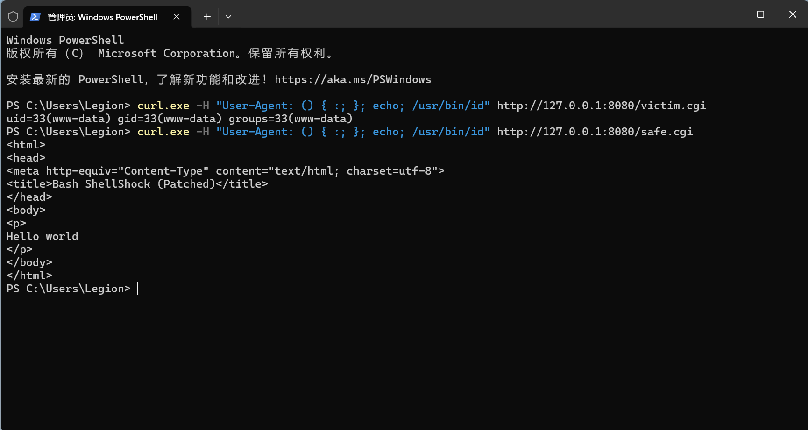

---
AIGC:
    Label: "1"
    ContentProducer: 001191440300708461136T1XGW3
    ProduceID: fa6d20be7fee21a8b0b752ab67751b4b_7774455acc3c11f1b76f525400638852
    ReservedCode1: Pjq7jY2ieaL6qEeN2buF/KUDfdQtcqSQe+z6sYSJ2U4JyqXKMiHCpiZDLmAgeymmDbHepq5H6dU6au9iww088qsivy/zO+FvcC5k7DCXIhaXRRyQeTD2Gj4wwhCubeD27+1JP3iwfUVrU5jNCdfiU+9g/mh/zmc11SJKKdn9ppupfciBZq3IMXySouw=
    ContentPropagator: 001191440300708461136T1XGW3
    PropagateID: fa6d20be7fee21a8b0b752ab67751b4b_7774455acc3c11f1b76f525400638852
    ReservedCode2: Pjq7jY2ieaL6qEeN2buF/KUDfdQtcqSQe+z6sYSJ2U4JyqXKMiHCpiZDLmAgeymmDbHepq5H6dU6au9iww088qsivy/zO+FvcC5k7DCXIhaXRRyQeTD2Gj4wwhCubeD27+1JP3iwfUVrU5jNCdfiU+9g/mh/zmc11SJKKdn9ppupfciBZq3IMXySouw=
---

# CVE-2014-6271 Shellshock 修复报告

## 1. 漏洞概述

- **CVE 编号**：CVE-2014-6271（Shellshock / Bash 破壳漏洞）
- **影响范围**：Bash 1.14 ~ 4.3（未打补丁版本）
- **漏洞本质**：Bash 在处理以 `() {` 开头的环境变量时，会把后续命令当作函数体进行解析并执行。攻击者可借此实现**远程代码执行（RCE）**。
- **官方参考**：官方描述见 [NVD - CVE-2014-6271](https://nvd.nist.gov/vuln/detail/CVE-2014-6271) 与 [MITRE - CVE-2014-6271](https://cve.mitre.org/cgi-bin/cvename.cgi?name=CVE-2014-6271)。

## 2. 攻击原理

1. Apache CGI 机制会将 HTTP 请求头（如 `User-Agent`）注入为环境变量（`HTTP_USER_AGENT`），再将其传给 CGI 脚本的解释器。
2. 攻击者在请求头中放入形如 `() { :; }; echo; /usr/bin/id` 的载荷：
   - `() { :; }` 部分被 Bash 解析为一个函数定义；
   - 解析完函数体后，`;` 之后的命令（`echo; /usr/bin/id`）会**继续被执行**，从而实现命令注入。
3. 由于 CGI 脚本以 Bash 作为解释器（shebang 指向 Bash），未打补丁的 Bash 会错误解析环境变量中的函数定义，并执行后续命令，形成 RCE。

## 3. 实验环境

| 组件 | 说明 |
|------|------|
| 靶场 | vulhub 镜像 `vulhub/bash:4.3.0-with-httpd` |
| 启动方式 | docker compose 启动容器 |
| 端口映射 | 宿主机 8080 -> 容器 80 |
| 漏洞脚本 | `victim.cgi`：shebang 指向未打补丁的 `/usr/local/bash-4.3.0/bin/bash` |
| 修复脚本 | `safe.cgi`：shebang 指向已打补丁的 `/bin/bash` |

## 4. 复现过程与输出

**复现命令**：

```bash
curl.exe -H "User-Agent: () { :; }; echo; /usr/bin/id" http://127.0.0.1:8080/victim.cgi
```

**执行结果**：

- HTTP 状态码：`200`
- 响应 body：`uid=33(www-data) gid=33(www-data) groups=33(www-data)`

**结论**：成功在服务器上执行了 `/usr/bin/id` 命令，获取到运行 Web 服务的用户身份（www-data），证明命令注入成功，漏洞可被利用。

## 5. 修复对照

对同一 payload 访问修复脚本：

```bash
curl.exe -H "User-Agent: () { :; }; echo; /usr/bin/id" http://127.0.0.1:8080/safe.cgi
```

**执行结果**：

- 返回正常 HTML 页面（Hello world）
- 无任何命令输出，`/usr/bin/id` 未被执行

**结论**：已打补丁的 Bash（`/bin/bash`）不再把环境变量中的 `() {` 内容当作函数定义后的命令执行，补丁有效。

**复现与修复对照截图**（上半部分为 `victim.cgi` 命令注入成功，返回 `uid=33(www-data)`；下半部分为 `safe.cgi` 修复后仅返回正常 HTML）：



## 6. 修复方案

1. **升级 Bash**：升级到已修复版本（Bash >= 4.3-29 或 4.4+），官方补丁修复了环境变量函数定义解析缺陷。
2. **避免将不可信输入作为环境变量导入**：不让外部可控数据（如 HTTP 头）直接进入环境变量并传递给 Bash。
3. **加固 CGI 环境**：限制可注入的 HTTP 头数量，使用安全解释器（或非 Bash 解释器）执行 CGI 脚本。
4. **部署 WAF/IDS**：在网络层拦截包含 `() {` 特征（如 `() { :; };`）的请求，阻断利用尝试。

## 7. 踩坑记录

- **现象**：原始靶场脚本执行时返回 HTTP 500，`exec` 失败。
- **原因**：原始靶场脚本使用 **CRLF 行尾**，导致 shebang 路径末尾带上 `\r` 字符（如 `#!/usr/local/bash-4.3.0/bin/bash\r`），解释器路径不存在，exec 失败。
- **解决**：将脚本转换为 **LF 行尾**后，脚本可正常执行。
*（内容由AI生成，仅供参考）*
